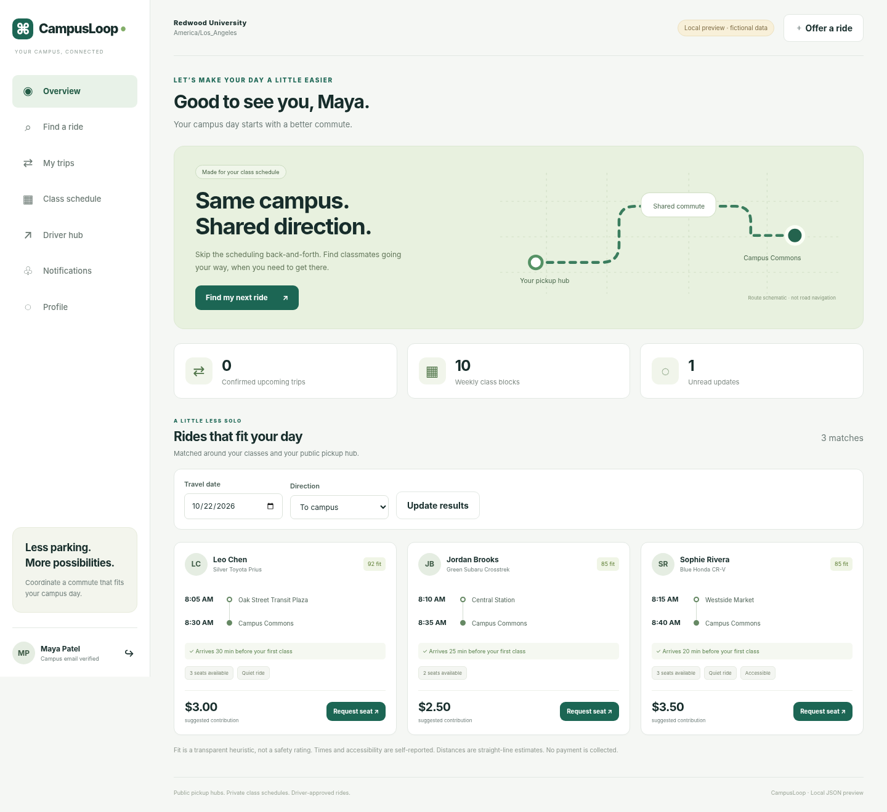

# CampusLoop

### Your campus. Your schedule. A shared direction.

A schedule-aware college carpooling application with **Next.js, React, TypeScript,
NestJS, PostgreSQL, Prisma, REST APIs, and Docker**. Students maintain a private
weekly class schedule, find compatible rides, and coordinate driver-approved
bookings at public pickup hubs.



*Screenshot: the included local no-build preview, connected to the actual shared
application core through an HTTP test bridge. It is **not a screenshot of a
validated Next.js build**. All people, schools, classes, rides, and coordinates
shown here are fictional demonstration data.*

## Two ways to explore

| Mode | Implementation | Validation status |
|---|---|---|
| **Full-stack source** | Next.js/React UI → NestJS REST API → Prisma → PostgreSQL; SMTP outbox worker | Source, migrations, Docker recipes, and CI/integration tests included. Framework build, real PostgreSQL, Docker and SMTP were **not run in the creation environment**. |
| **Local preview** | No-build JavaScript UI → Node HTTP adapter → **the same TypeScript application core** → local JSON store | Core, HTTP, and browser interactions tested. Not a substitute for the full-stack validation. |

**Start with [START_HERE.md](START_HERE.md).** A working offline preview is included
because npm downloads and Docker/PostgreSQL were unavailable during development.
The preview is clearly labeled and never impersonates those technologies.

## Product workflows

- **Accounts and campus verification:** registration against a configured campus
  email domain, one-time verification codes, password reset, revocable HttpOnly
  cookie sessions, and self-service profiles. Email proves control of an address,
  not enrollment or driver eligibility.
- **Private class schedules:** weekly classes with term dates, overlap checks,
  campus-local times, and conflicts against confirmed trips. Other users never
  receive a student's class list.
- **Ride discovery:** transparent ranking by pickup proximity, class/target-time
  fit, cost, and available seats; optional quiet-ride and vehicle-accommodation
  filters. There is no hidden ML model or road-routing claim.
- **Driver hub:** owned vehicles, one-time or recurring ride offers, request
  review, cancellations, and manual completion after scheduled arrival.
- **Booking lifecycle:** idempotent requests, driver confirmation, waitlists,
  cancellation, seat return, and a promoted waitlist request that still needs
  approval. A pending request never reserves a seat.
- **Trip coordination:** participant-only messaging, calendar downloads,
  persisted notifications, completed-trip reviews, private reports, and a
  moderator resolution queue.
- **Engineering controls:** ownership checks, bounded inputs and queries,
  state-transition validation, audit events, transactional email outbox,
  database constraints, and serializable transaction retries.

## Quick local preview — no install required

Install **Node.js 22.16+**, extract this repository, then run:

```bash
node demo/server.cjs
```

Open **http://localhost:3400**. Use the **Rider**, **Driver**, or **Moderator** button
on the sign-in page, then click **Sign in**. The seeded password is intentionally
public and only for fictional, loopback-bound demo accounts.

```text
Rider:     maya@students.redwood.example
Driver:    leo@students.redwood.example
Moderator: admin@students.redwood.example
Password:  CampusLoop-Demo-2026!
```

The preview persists to `.local/demo.json`, excluded from Git. Use
`node demo/server.cjs --reset` to start fresh. Keep the preview private and never
put real student or driver data into it. Verification/reset emails stay in the
local outbox; `node scripts/demo-mail.cjs` shows the fictional mailbox.

## Full-stack setup

Requires Docker with Compose and internet access to package/image registries.
These recipes are included but **not runtime-validated here**.

```bash
node scripts/setup.cjs
docker compose up -d --build
docker compose run --rm seed
```

Then open **http://localhost:3000**. The same demo accounts are available.
Mailpit displays locally captured verification/reset mail at **http://localhost:8025**.
The seed command refuses a nonempty database and refuses production mode.

For native Node development, database integration tests, and Windows notes, see
[docs/DEVELOPMENT.md](docs/DEVELOPMENT.md).

## Why booking concurrency matters

Two drivers should not confirm the same rider into overlapping trips, and two
riders should not receive the final seat simultaneously. The application repeats
all relevant checks **inside** the write transaction: current actor, ride state,
current booking state, capacity, class conflicts, and existing confirmed trips.
The Prisma adapter uses PostgreSQL `Serializable` isolation and bounded retries
for serialization conflicts. Booking uniqueness and capacity checks also exist
in the database. Notifications, audit events, and outbox entries commit with the
booking change; SMTP is performed only after commit.

**Memory-adapter race tests passed. Real PostgreSQL race tests are included but
were not run here.** See [docs/ARCHITECTURE.md](docs/ARCHITECTURE.md) and
[reports/VALIDATION.md](reports/VALIDATION.md).

## Repository map

```text
apps/web/                  Next.js App Router + React/TypeScript application
apps/api/                  NestJS HTTP adapter, Prisma store, SMTP worker
packages/core/src/         Shared typed business rules and API routing
prisma/schema.prisma       Relational data model and associations
prisma/migrations/         Initial SQL migration and integrity constraints
demo/                      Separate no-build preview + compiled core snapshot
tests/                     Node unit, domain, HTTP, and security tests
tests/integration/         Explicitly gated PostgreSQL integration tests
tests/e2e/                 Playwright tests for the real Next/Nest stack
scripts/                   Setup, seeding, browser checks, core snapshot sync
reports/                   Measured validation results and boundaries
docs/                      Architecture, API, security, publishing, screenshots
.github/workflows/         Core/build, PostgreSQL, and real-stack browser CI jobs
```

## Tests

```bash
# Uses the committed compiled core; no npm dependencies required.
npm run test:offline

# After installing development dependencies: compile TypeScript, sync and test.
npm install
npm test
npm run db:generate
npm run typecheck
npm run build
```

The release includes **100 passing Node tests** and **16 passing browser workflow
checks**. Browser checks used a Python HTTP bridge to the real preview server
because direct browser navigation was administratively blocked. They do not
validate native browser cookie enforcement, Next.js, or NestJS.

See [reports/VALIDATION.md](reports/VALIDATION.md) for exactly what ran. CI workflow
files are provided; their presence is not a claim that GitHub Actions has run.

## Documentation

[Architecture](docs/ARCHITECTURE.md) · [API reference](docs/API.md) ·
[Development](docs/DEVELOPMENT.md) · [Security](SECURITY.md) ·
[Validation](reports/VALIDATION.md) · [Publishing](docs/PUBLISH.md) ·
[Portfolio guide](docs/PORTFOLIO.md)

## Boundaries

This is a portfolio prototype, not a transportation provider or campus-endorsed
service. It does not verify identity, age, enrollment, insurance, licensing,
vehicle safety, or actual ride completion. It offers no payments, live location,
road directions, background checks, emergency response, university SSO, or class
system integration. Suggested contributions are informational; there is no
checkout or billing. Trip timing and accommodations are self-reported.

Before any real deployment, see [SECURITY.md](SECURITY.md). Before describing the
project on a resume, use the evidence-aware wording in
[docs/PORTFOLIO.md](docs/PORTFOLIO.md) and validate the full stack yourself.

MIT licensed. This repository is a newly authored implementation of the college
carpooling project concept, not a reconstruction of earlier private source code.
