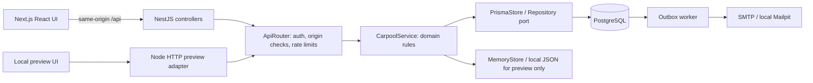
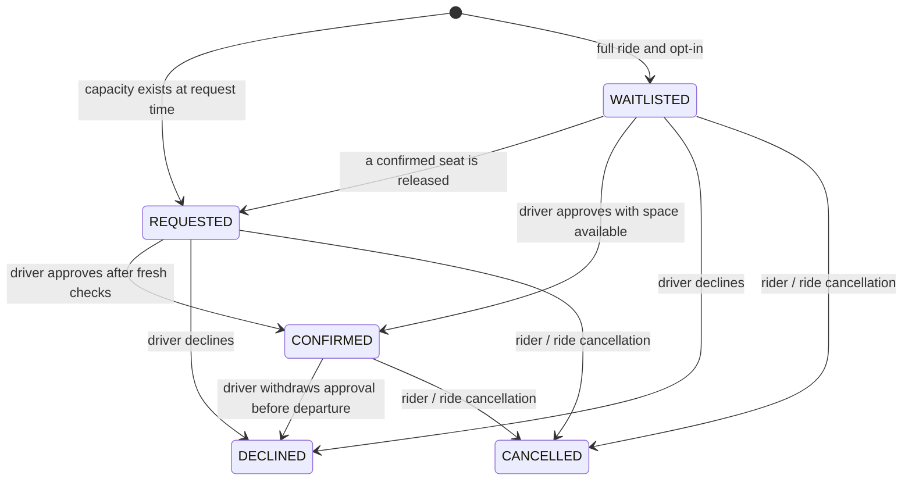

# Architecture and design decisions

## Boundaries



The framework-independent core is TypeScript, not a mock implementation of the
product. Both HTTP adapters use its authentication, validation, matching and
booking logic. PostgreSQL replaces the repository adapter rather than duplicating
business rules. The intentionally separate preview proves those rules and makes
the product inspectable without pretending to have built unavailable frameworks.

## Data model

The 17 relational models are Campus, Hub, User, Session, ActionToken, Course,
Vehicle, Ride, Booking, Message, Notification, Report, Audit, Outbox, Idempotency,
RateBucket and Review. See `../prisma/schema.prisma` for concrete associations.
All models use textual IDs; application-created IDs are random UUIDs, while the
fictional seed has readable fixture IDs. Date/time instants use timestamptz(3).
Term dates remain ISO date strings and class times are local minutes since midnight.

### Invariants

1. One booking record per rider per ride. Terminal requests are not reopened in v1.
2. A ride's confirmed seat count must remain between zero and capacity.
3. Only the driver (or a platform moderator for cancellation) can manage an offer.
4. Class schedules and a rider's confirmed trips must not overlap new confirmations.
5. Public pickup hubs and offers must belong to the user's campus.
6. Only the driver and confirmed riders can read/send trip messages.
7. All authorization is checked on the server. Client navigation is not access control.
8. Declining/cancelling a confirmed booking releases exactly one seat; retries are safe.
9. Pending requests and waitlists do not hold seats or authorize chat.
10. Outbox and notification writes are atomic with the action that caused them.

### Booking state machine



The earliest waitlisted request is promoted when a confirmed seat is released.
Promotion still needs explicit approval. This is not a guaranteed FIFO allocation
policy: the driver makes the final approval decision. Requests lock at departure.
Drivers manually mark a ride complete after arrival; this is self-reporting, not
GPS evidence. Unapproved requests close on completion. Overdue, uncompleted rides
remain visible in history; production would need an expiry/reconciliation job.

## Concurrency and idempotency

Every mutation runs inside the Store transaction boundary. The Prisma adapter
uses `Serializable`, a 15-second transaction timeout and at most six attempts for
Prisma serialization conflicts (P2034). It reexecutes the **entire** callback.
There are no SMTP/network side effects inside that callback. ID and token creation
is acceptable to repeat because failed transactions never publish those values.

Seat allocation reads current capacity and confirmed trips, updates the seat
count, records the booking state, and adds notifications/audit/outbox rows in one
transaction. The two-confirmation write-skew case is covered by a planned real
PostgreSQL integration test as well as memory-adapter domain tests. The latter
serialize in one process and cannot establish PostgreSQL SSI behavior by themselves.

A caller-supplied idempotency key is scoped to the authenticated rider and a
canonical hash of ride ID, note and waitlist consent. Reusing it for different
input is a conflict. Replaying a matching key returns the existing booking,
possibly with its newer current status. Keys expire after 24 hours. The booking
uniqueness constraint still applies after key expiry.

## Matching

Hard constraints: same campus, open/future offer, valid route direction, requested
cost limit, optional quiet/vehicle-accommodation filters, chosen hub distance,
class conflicts, and confirmed-trip conflicts. If the day has classes, inbound
rides must arrive at least the requested buffer before the first class; outbound
rides must leave that buffer after the final class. Manual target time can override
the first/last-class target, but actual class conflicts still apply. A two-hour
maximum early/late gap avoids implausibly remote matches.

The documented ranking formula is:

```text
score = max(0, round(100 - straightLineKm * 12
  - abs(gapMinutes - bufferMinutes) * 0.35
  - costCents / 200 - (fullRide ? 15 : 0)))
```

When no time target exists, the time penalty is 12. Scores are **heuristics**, not
probabilities, safety assessments, model predictions, or claims of optimal routing.
Haversine measures straight-line distance between selected public hubs. Walking
paths, driving ETA, traffic, transfers and detours are not calculated.

## Time zones

Campus time is authoritative. Offers contain an ISO local date and local HH:mm
values; the server converts them to UTC instants. The converter rejects nonexistent
spring-forward times and ambiguous fall-back minutes rather than silently choosing
a different time. The currently supported campus zones use quarter-hour UTC
offsets. User input cannot choose arbitrary zone names. Overnight rides are excluded.
Recurring batches contain actual ride instances and commit all-or-nothing.

## Email delivery

The worker leases one eligible outbox message transactionally, sends it after
commit, and records success or exponential-backoff failure. Leases expire after
five minutes and retries stop after five attempts. Successful delivery redacts the
recipient/body from the stored row. Failed rows remain for manual intervention.
There is **no exactly-once email guarantee**: a crash after SMTP accepts a message
but before its database acknowledgement can deliver a duplicate. Message IDs help
operators correlate retries but do not eliminate that uncertainty.

## Deliberate limits and next improvements

Lists are bounded: matches inspect at most 200 departures per campus/day; history
and notifications return the latest 100; messages return the latest 100. The UI
reports truncated matching results. This is a small-campus prototype, not a
benchmark of large-scale queries. Next steps are cursor pagination, batched joins
instead of N+1 hydration, expired-request reconciliation, rate-bucket/token cleanup,
monitoring, university-managed authentication, and independently reviewed safety
operations before any real use. The product currently polls messages/updates; it
does not claim WebSockets or live GPS.
